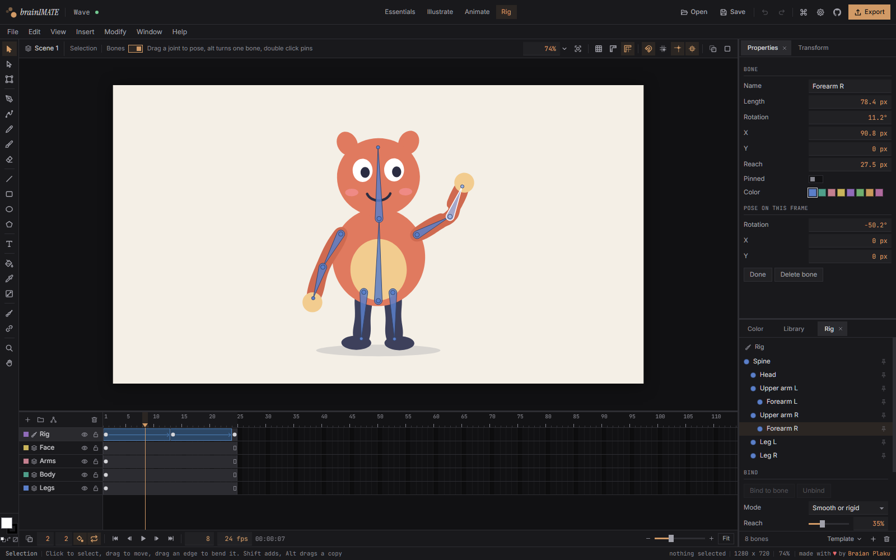

<p align="center">
  
</p>

<h1 align="center">brainIMATE</h1>

<p align="center">
  Vector drawing and 2D animation that run in your browser.<br/>
  Draw it, then make it move.
</p>

<p align="center">
  
</p>

<p align="center">
  <a href="https://anima.swimmingbrain.dev"><strong>Try it now &rarr; anima.swimmingbrain.dev</strong></a>
</p>

brainIMATE is an open source app for drawing and animating, like Adobe Animate and Illustrator, but in a browser tab. It is made for illustrators and for people who never animated before. There is no account and no server, everything stays in your browser.

The welcome screen opens three examples to look into: a rigged character that waves, a bouncing ball with squash and stretch, and a logo with a gradient.

## Features

- Pen, curvature, pencil, brush, eraser, polygons and stars, every line stays an editable curve
- Unite, subtract, intersect, exclude and divide shapes, holes stay part of their shape, outline strokes, simplify and smooth paths
- Solid colors and linear or radial gradients, a color picker, swatches, paint bucket, ink bottle and eyedropper
- Align, distribute and transform by numbers, rulers, guides, a grid and smart guides that snap
- A timeline with layers and folders, keyframes, labels and tweens that blend moves, turns, shapes and colors
- Easing from simple in and out to your own curve, playback with a loop and onion skin before and after the playhead
- Frames to copy, paste, move, duplicate and reverse, with auto key on the frame you draw on
- Bones for characters, bound to the drawing and posed with inverse kinematics, see Rigging below
- Symbols you draw once and reuse from a library, edited in place, played in a loop, once or on one frame, with alpha and a tint
- Text with bundled fonts, your own font files or the fonts on your computer, typed right on the stage, turned into outlines when you need paths
- Pictures imported, dropped or pasted onto the stage, and copy and paste between tabs through the system clipboard
- SVG import from Illustrator, Inkscape and the web: paths, shapes, groups, class styles, gradients and text stay editable
- `.brainimate` files that carry their pictures and fonts, open, save and save as, recent files with thumbnails, a project dropped on the window opens
- Autosave in the browser two seconds after every change, a restore on the welcome screen when the tab closed before a save
- Export a frame to PNG or SVG, the animation to GIF, WebM, MP4, a PNG sequence or a sprite sheet with a json for game engines, posed rigs included
- A command palette (`Ctrl+Shift+P`) that finds every command by a few letters, with the ones you ran last on top
- Offline use once loaded

### Comic stories for vertical video

- A TikTok 9:16 preset at exactly 1080 by 1920 pixels, 24 or 30 fps, first in the new document form
- Safe zones on a 9:16 stage that shade where the app puts its buttons and captions, View > Video safe zones, they never show in an export
- Comic scene layers: background, midground, characters, foreground and speech bubbles, from the new document form or Insert > Comic scene layers
- A Comic workspace with the stage, the timeline and the swatches up front
- Ink brushes for a hand drawn graphic novel look: Comic ink, Bold contour, Face detail and Cel shade (paints behind the lines), the pencil adds Comic line and Rough ink
- A muted comic palette on top of the swatches, on from the start, the plus copies it into the document
- Comic lettering fonts with the german umlauts: Comic Neue, Bangers and Patrick Hand
- Export and share: on an iPad the finished video goes straight to the photos or to an app through the share sheet

### iPad, fingers and the Apple Pencil

- Two fingers pinch to zoom and move the stage, two fingers tapped undo, three redo
- The pencil draws with its pressure, a hand resting on the screen is ignored. Fingers draw until the pencil is used, from then on they move the view and tap to select
- A finger that lands while another one draws turns the stroke into a pinch, nothing is left behind
- The touch bar under the stage: undo, redo, selection, brush, eraser, text, shapes, fill color with the comic palette, size, zoom, fit, layers, panels, save and more
- The keys on the edge of the stage: Shift, Alt and Ctrl stay on until tapped again, Done stands in for Enter, Cancel for Escape, the bin takes the last anchor or the selection
- A long press opens the menu of an object, a layer, a frame or a symbol
- In portrait the panels open as a drawer over the stage, in landscape they can be put away, the page never scrolls
- Pictures larger than the stage could show come in smaller, a 12 megapixel photo uses a third less memory
- Preferences > Canvas > Touch and pencil sets when the touch bar shows and what one finger does

### Camera, parallax and shots

- A camera layer on the main timeline: position, zoom, turn, handheld shake and the bob of walking, keyed like any layer and moved with the usual eases. Insert > Camera, or the Camera panel
- The camera view (`Shift+C`, the touch bar) shows the stage as the video does, playback switches to it by itself. On a tablet it draws at half the pixels while playing, the export always at full size
- The camera tool (`C`): drag the camera frame to move it, a corner to zoom, the knob to turn it. In the camera view a finger drags the picture like a camera held in the hand
- Parallax per layer or folder: 1 follows the camera, less is further back, more is in front, 0 stays on the screen. One tap sets the comic scene layers to background 0.3, midground 0.65, characters 1, foreground 1.4 and bubbles 0
- Moves put down as keyframes from the playhead, with their length, strength and ease: first person walk, slow push in, cinematic zoom, pan left and right, look left and right, tracking shot, focus pull and handheld camera
- A new shot on a camera keyframe: cut, fade through a color, crossfade, zoom, slide or a camera move, each as long as you like
- The export, the thumbnails, the SVG export and the camera view draw through the same function, the video looks like the preview. See [docs/KAMERA.md](docs/KAMERA.md)

### Characters, faces, voice and the library

- A character creator for the graphic novel look: build, head, hair, colors, outline and how much the lines wobble, every part a flat fill with a cel shadow and a hand drawn outline
- A skeleton of twenty three bones with a thumb, an index finger and the other fingers on each hand, parts bound rigidly and round at the joints, dragged by a finger with ik, the upper arms and legs pinned so a pulled hand bends the elbow only
- Animations as pose keyframes: idle, walk, run, jump, wave, point, sit, turn around, reach and grab, with repeat, speed, distance, direction, mirror and going back, stopped at the playhead
- Faces with seven moods, three mouth shapes, blinks and talking, every part morphs from one to the next
- Sounds on the timeline, played with it and put into the video as aac, lip sync from how loud a voice is
- Objects taken into a hand at the playhead and put down later
- A character library in the browser: save, rename, copy, delete, insert into any project, a file to move characters between devices. See [docs/CHARAKTERE.md](docs/CHARAKTERE.md)
- A look for every character, also later: ten hairstyles, eye shapes with size, height and spacing, brow styles, an optional nose (off for new characters) with shape, size and place, mouth width; ten moods and nine mouths
- Hand poses: relaxed, open, fist, pointing, grabbing, holding a product, the fingers close round what a hand takes
- Walks and runs with planted feet, two bone ik legs, a hip that drops and bobs, arms that swing a little late; standing shifts the weight between the legs
- Characters together: look at, point at, wave to, shake hands, hand an object over, hug, reactions, a cast list that folds the others in the timeline, groups that move together
- Moves for product videos: walk into the picture, toward the camera, take a product, hold it to the camera, point at an object, turn, leave; moves of your own saved by bone name for any character
- A scene library: seven ready made places in the comic style (living room, office, kitchen, shop with products to take, street, bedroom, storage room), whole scenes kept in the browser, inserted into a project or opened as one, scene files. See [docs/FIGUREN-UND-SZENEN.md](docs/FIGUREN-UND-SZENEN.md)
- Characters seen and turned from every side: front, 3/4, side, back 3/4 and back from one body laid out in the room, so face, hair, clothes, colors and proportions match; smooth turns, the head turned apart (look at the camera, over the shoulder), walks from the front and the back, toward and away from the camera; a turnaround editor with clothes, glasses, hats, proportions and fine tuning per view; older characters made turnable. See [docs/ANSICHTEN.md](docs/ANSICHTEN.md)
- Characters with identities of their own: male, female and individual bodies with shoulders, chest, waist and hips drawn from every side; 19 hairstyles in 10 hair colors; tops, bottoms, shoes and extras (watches, bags, jewelry, glasses, hats) in many colors; face shapes, eye colors, freckles, beards and make-up; every new character gets its own look; a creator in nine pages; two main characters kept in the library with a locked look for a series. See [docs/FIGUREN-IDENTITAET.md](docs/FIGUREN-IDENTITAET.md)

### Customization

Preferences (`Ctrl+K`) has a tab for each part. Tools: show, hide and drag the tools of the toolbar into your own order, on the left or the right, small or normal. Pens: brush and pencil presets you save from the stage bar, the eraser size and how the pen draws its anchors and rubber band. Canvas: grid size, subdivisions, color and opacity, guide and smart guide colors, the pasteboard, the wheel and a tablet mode with bigger hit areas. Shortcuts: record any key for any command, a clash shows in red until you keep or undo it. Workspaces: Essentials, Illustrate, Animate and Rig set the panels, sizes, toolbar side, rulers and bones, and you can save your own next to them.

### Rigging

Draw an arm on a layer, press `M`, click the shoulder, the elbow and the wrist, press `Esc`. A Rig layer appears and the arm is bound to its two bones. Press `V`, drag the wrist, and the arm bends at the elbow with its curves kept smooth. Alt drag turns one bone, a double click pins a joint, posing on another frame keys it and tweens to it. The bind tool (`Shift+M`) changes what follows which bone, the Rig panel lists the bones and adds humanoid, four legged and arm templates.

## Shortcuts

| Key | What it does |
|-----|--------------|
| `V` `A` `Q` | Selection, direct selection, free transform |
| `P` `Shift+P` `Y` `B` `E` | Pen, curvature, pencil, brush, eraser |
| `R` `O` `N` `T` | Rectangle, ellipse, line, text |
| `F8` `Ctrl+L` | Convert to symbol, library |
| Double click `Esc` | Edit a symbol in place or type into text, leave the symbol |
| `Ctrl+Shift+O` | Create outlines from text |
| `K` `S` `I` `G` | Paint bucket, ink bottle, eyedropper, gradient |
| `M` `Shift+M` | Bone (`Esc` ends the chain), bind |
| `Z` `H` `Space` | Zoom, hand, hand while held |
| `Ctrl+=` `Ctrl+-` `Ctrl+1` `Ctrl+0` | Zoom in, zoom out, 100 percent, fit |
| `Ctrl+D` `Ctrl+A` `Delete` | Duplicate, select all, delete |
| Arrows | Nudge 1 px, 10 px with `Shift` |
| `Ctrl+G` `Ctrl+Shift+G` `Ctrl+B` `Ctrl+J` | Group, ungroup, break apart, join paths |
| `Ctrl+Up` `Ctrl+Down` | Bring forward, send backward, with `Shift` to the front or back |
| `Enter` `Esc` `Backspace` | End the pen path, or take back its last anchor |
| `X` `Shift+X` `D` | Fill or stroke in front, swap them, default colors |
| `Ctrl+R` `Ctrl+;` `Ctrl+'` `Ctrl+U` | Rulers, guides, grid, smart guides |
| `F5` `F6` `F7` | Insert frame, keyframe, blank keyframe |
| `Shift+F5` `Shift+F6` | Remove frame, clear keyframe |
| `,` `.` `Enter` | Previous frame, next frame, play and pause |
| `Shift+,` `Shift+.` | First and last frame |
| `Ctrl+Alt+C` `Ctrl+Alt+V` | Copy and paste frames |
| `Alt+Shift+O` | Onion skin |
| `Ctrl+Z` `Ctrl+Shift+Z` | Undo, redo |
| `Ctrl+O` `Ctrl+S` `Ctrl+Shift+S` | Open, save, save as |
| `Ctrl+I` `Ctrl+E` | Import, export |
| `Ctrl+Shift+P` `Ctrl+K` | Command palette, preferences |
| `?` | All shortcuts, they can all be changed in the preferences |

## Running locally

```bash
pnpm install
pnpm dev
```

Open `http://localhost:5173`. `pnpm test` runs the tests, `pnpm check` the type checks and `pnpm build` writes the static site to `build/`. See [docs/CONTRIBUTING.md](docs/CONTRIBUTING.md) if you want to help.

## How it works

- The stage is two stacked canvases, the drawing below and the handles on top. Both are drawn only when something changed. While you edit, the layers under and over the one you work on are kept as two pictures, so a drag only draws its own layer, and a grid of the item boxes finds what is under the pointer without testing every shape.
- A drawing is a list of paths made of cubic curves, kept as plain objects. Undo stores immer patches, not copies.
- A layer holds keyframes. Between two keyframes with a tween, items with the same id are blended: the transform as move, turn, scale and skew, the paths point by point, the colors in rgb. A frame is worked out once and kept, so playback only pays for frames it has not seen.
- Onion skin draws the frames around the playhead offscreen, tints them and keeps the result until something changes.
- A symbol has its own layers and keyframes. An instance works out which of its frames to show from the frame it is on, and draws those layers with its own matrix, alpha and tint. Editing in place swaps the timeline for the symbol's and draws the rest of the stage faded.
- Text is laid out with opentype.js and drawn from the glyph outlines, so it looks the same on every machine and turns into paths without loss.
- Bones live on a rig layer and a pose is a keyframe on it. Each anchor of a bound shape follows a weighted mix of its bones, its handles follow how that mix changes along the outline, and the bent shapes are worked out once per pose.
- A `.brainimate` file is a zip with the document as json and each picture and font as its own file next to it. A plain json with the files inside as data urls opens too.
- Exports draw every frame offscreen with the same renderer as the stage, so bones, tweens and symbols look the same. SVG export writes the shapes the rig bent in place and text as text or as outlines.

## Tech stack

| Part | Library |
|------|---------|
| Framework | Svelte 5 + SvelteKit (static adapter) |
| Curves | bezier-js, fit-curve |
| Shape booleans | paper, loaded when first used |
| Brush | perfect-freehand |
| Undo | immer |
| Easing | bezier-easing |
| Text | opentype.js |
| Fonts | Inter, Instrument Serif, JetBrains Mono, Lora, Poppins, Bebas Neue, Comic Neue, Bangers, Patrick Hand from Fontsource (OFL) |
| Export | gifenc, mediabunny, @mediabunny/aac-encoder (FFmpeg aac in WebAssembly, LGPL), fflate |
| SVG import | svg-pathdata |
| Storage | idb-keyval, browser-fs-access |
| Shortcuts | tinykeys |
| Language | TypeScript |

## License

MIT, see [LICENSE](LICENSE). The libraries keep their own licenses, [THIRD_PARTY_LICENSES](THIRD_PARTY_LICENSES) lists them.
